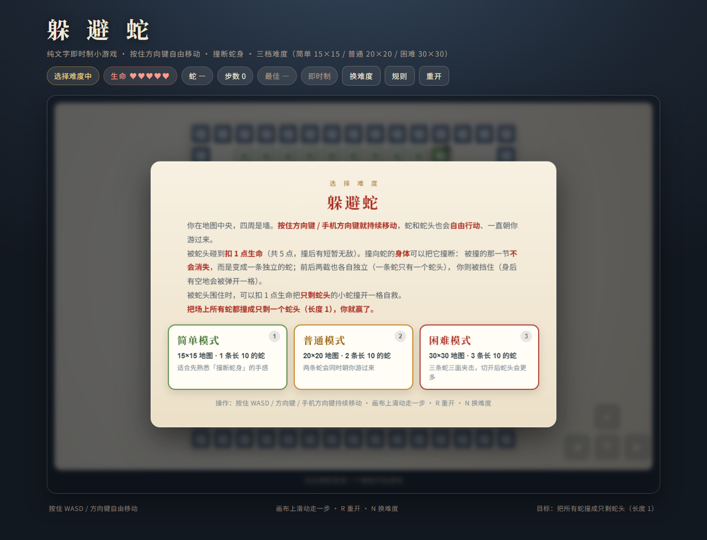
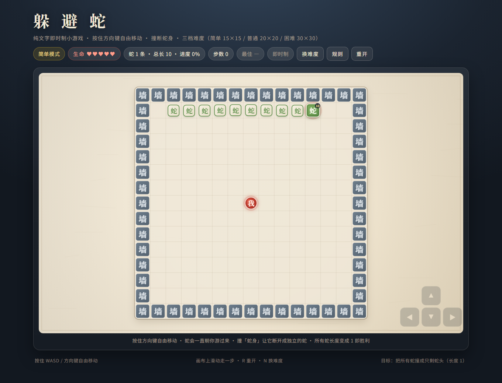
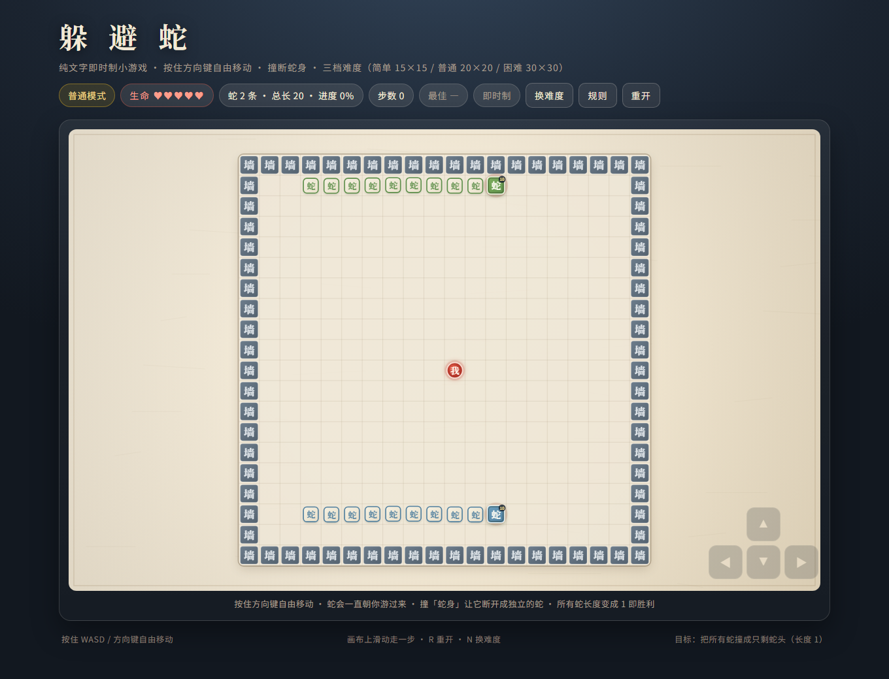
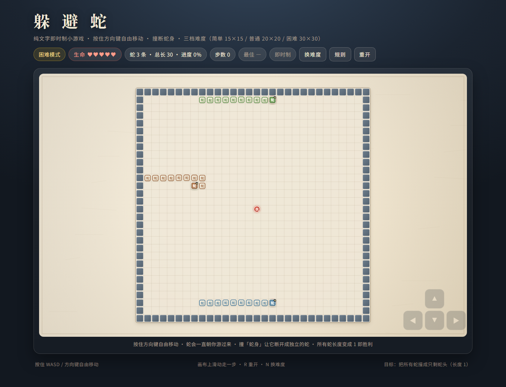
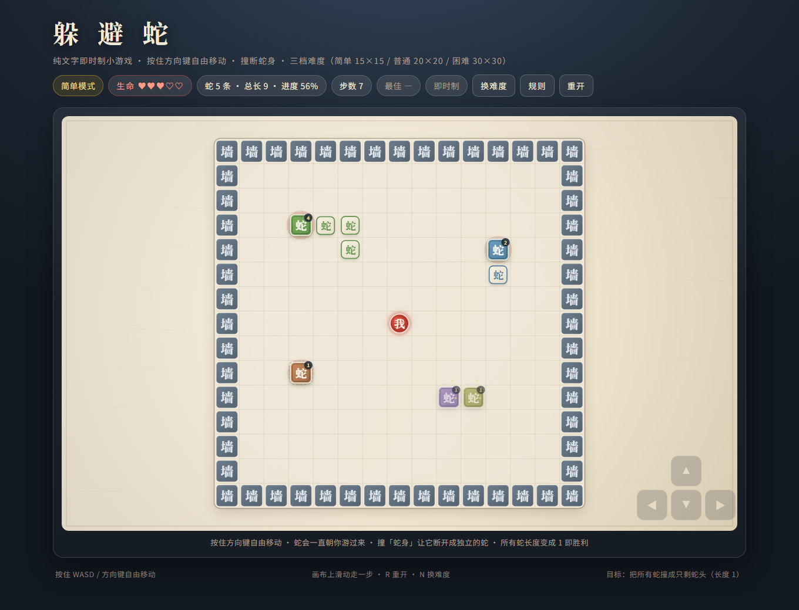

# 躲避蛇 · 需求说明与实现文档

> 本文档把「躲避蛇」这个本地网页小游戏的**全部需求**写进来，并记录实现方式、规则细化、
> 算法来源、运行方法与测试结果。
>
> 游戏目录：`D:\godot_engine\New\文字游戏\躲避蛇\`
> 参考程序：`D:\godot_engine\New\文字游戏\worddage\`（我推字 · 文字解谜）
> 另有一个 **Lua 千星奇遇版**：`D:\godot_engine\New\文字游戏\躲避蛇_千星奇遇\`（见该目录《导入与搭建说明.md》）

---

## 1. 项目是什么

**躲避蛇** 是一个纯前端、零依赖、本地可玩的**即时制**（实时）网页小游戏：

- 你控制文字「**我**」，处在地图正中央，四周一圈「**墙**」；
- **按住方向键我就持续移动**，松开就停；蛇也会**自由行动**，一直朝你游过来；
- 被蛇头碰到就**扣 1 点生命**（共 **5 点**）；
- 朝蛇的**身体**撞过去可以把它**撞断**：被撞到的那一节**不会消失**，而是变成一条**独立的蛇**
  （长度 1）；断点前后的蛇身也各自变成独立的蛇；
- 被蛇头围住时，可以把**只剩蛇头**的小蛇往前**撞开一格**（代价是 1 点生命），借此自救；
- 当场上**所有蛇的长度都变成 1**（每条蛇只剩一个蛇头）时，**玩家胜利**；
- 开始游戏时通过**弹窗选择难度**（简单 / 普通 / 困难），三档地图大小与蛇的数量不同。

---

## 2. 原始需求（按用户要求逐条记录）

1. 参考 `D:\godot_engine\New\文字游戏\worddage` 的程序，在 `D:\godot_engine\New\文字游戏\躲避蛇`
   目录下**新建一个游戏**。
2. 游戏的**背景图保持不变**。
3. **地图边缘有「墙」环绕**，「我」处在地图**中心**。
4. 将「**蛇**」相关的算法**导入**。
5. 游戏共分为**三个难度**：
   - **简单模式**：地图大小 **10×10**，初始有 **1 条长度为 10** 的蛇；
   - **普通模式**：地图大小 **15×15**，初始有 **2 条长度为 10** 的蛇；
   - **困难模式**：地图大小 **20×20**，初始有 **3 条长度为 10** 的蛇。
6. 「我」有 **5 点生命**，**每碰到「蛇」头一次，则损失一点生命**。
7. **被「我」撞击、导致分离出来的蛇，算作独立的蛇**；**一条蛇只有一个蛇头**。
8. **蛇头会自发地朝我移动，并撞击我**。
9. **游戏开始时，我可以通过弹窗选择游戏难度**。
10. 若场上的**蛇的长度均为 1**，则**玩家胜利**。
11. 据此给出一个**本地网页小游戏**。
12. 同时**新建一个 `.md` 文件**，将这些要求写进去（即本文档）。

### 2.1 第二轮补充需求（用户后续明确）

1. **蛇头也使用「蛇」字**（蛇头和蛇身都是「蛇」字块，不是圆形表情）。
2. **中间不需要用连接的符号**（蛇的每一节是独立的「蛇」字块，不要画连线）。
3. **被「我」撞到的「蛇」并不会消失，而是成为一个独立的蛇**（撞碎/消灭的旧做法取消）。

### 2.2 第三轮补充需求（用户后续明确）

1. **取消回合制**，「我」和蛇**均可以自由行动**（即时制 / 实时）。

### 2.3 第四轮补充需求（用户后续明确）

1. **简单模式地图大小调整为 15×15**、**普通模式调整为 20×20**、**困难模式调整为 30×30**
   （蛇的数量和初始长度不变：1/2/3 条、每条 10 节）。
2. **减少蛇被撞击后的硬直时间**（撞头/撞断后蛇头僵直的时间从 1.5 秒缩短为 0.7 秒）。

---

## 3. 需求对照表（需求 → 实现 → 验证）

| # | 要求 | 实现位置 | 验证 |
|---|------|----------|------|
| 1 | 在「躲避蛇」目录新建游戏 | 整个 `躲避蛇/` 目录 | — |
| 2 | 背景图保持不变 | `style.css` 的 `html,body` 背景**逐字沿用** worddage 的深色墨水径向渐变；画布宣纸底沿用 `art.js` 的 `drawPaper` | 页面测试：两份 CSS 的渐变字符串逐字一致 |
| 3 | 边缘有墙、我在中心 | `engine.js`：`reset()` 生成一圈墙；`centerOf()` 取地图中心 | 引擎测试：墙数量 = 2×(列+行)−4、我在中心、蛇/我不在墙里 |
| 4 | 导入蛇相关算法 | `engine.js`：从 worddage 移植**蛇身链 + 小火车跟随 + 可复现随机数**，随机走改为 BFS 朝我寻路 | 引擎测试：蛇头朝我、身体跟随旧位置、可复现 |
| 5 | 三档难度（尺寸/蛇数/长度） | `engine.js` 的 `DIFFICULTIES` | 引擎测试：三档地图、蛇数、每条长度 10 |
| 6 | 5 点生命、撞头扣 1 点 | `engine.js`：`hp = 5`；`damagePlayer()` | 引擎测试：撞头 5→4、生命归零失败 |
| 7 | 被撞的蛇成为独立蛇、一条蛇一个头 | `engine.js`：`splitSnake()`：被撞的那一节 → 独立蛇；前段保留原蛇头；后段 → 独立新蛇 | 引擎测试：1 条蛇撞成 2~3 条、id/颜色不同、每蛇 1 个蛇头 |
| 8 | 蛇头自发朝我移动并撞击 | `engine.js`：`update(now)` + `nextStepFor()`（BFS 最短路） | 引擎测试：蛇不用我行动也会自己动、撞我扣血 |
| 9 | 开始时弹窗选难度 | `index.html` 的 `#start-overlay` + `main.js` 的 `openDifficulty()` / `chooseDifficulty()` | 页面测试：启动即弹窗、点击/键盘 1/2/3 选难度 |
| 10 | 所有蛇长度为 1 → 胜利 | `engine.js`：`allLengthOne()`，每次撞断后判定 | 引擎测试：切成全 1 立即胜利、胜利后不能再动 |
| 11 | 本地网页小游戏 | `index.html` + `style.css` + `js/*.js`，**普通脚本**（不用 ES Module），**双击 `index.html` 即可玩** | 页面测试：脚本顺序、画布、渲染一帧 |
| 12 | 新建 `.md` 写清要求 | 本文件 `需求说明.md` | — |
| 补 1 | 蛇头也用「蛇」字 | `art.js`：`drawSnakeHead()` 画成「蛇」字块（深底白字、带长度角标） | 页面测试：渲染帧不报错；截图 |
| 补 2 | 中间不用连接符号 | `art.js`：`drawSnake()` 去掉连线，一节一个「蛇」字块 | 页面测试：渲染帧不报错；截图 |
| 补 3 | 被撞的蛇不消失、成为独立蛇 | `engine.js`：`splitSnake()` 不删除任何蛇身；`snakeStats().total` 全程守恒 | 引擎测试：随机 12 秒实时模拟中蛇身总节数始终不变 |
| 补 4 | 取消回合制、双方自由行动 | `engine.js` 改成**时间驱动**：`update(now)` 让蛇按各自计时器自由行动，`tryMove(dir, now)` 让「我」按移动速度随时行动；`main.js` 每帧调用 | 引擎测试：不用等玩家，蛇自己会动；按住方向键持续移动；页面测试 |
| 补 5 | 地图改为 15×15 / 20×20 / 30×30 | `engine.js` 的 `DIFFICULTIES`（含初始蛇摆放区域） | 引擎测试：三档 cols/rows = 15/20/30、墙体/初始蛇合法 |
| 补 6 | 减少蛇被撞击后的硬直 | `BALANCE.stunMs: 1500 → 700`（毫秒），撞头/撞断/被撞统一走这个值 | 引擎测试：`stunnedUntil === now + BALANCE.stunMs` |

---

## 4. 玩法规则（实现的完整规则）

### 4.1 地图与「我」

- 地图是正方形格子，**最外一圈全部是「墙」**，内部是空地；
- 「我」的起点永远是**地图正中心**（偶数边长时取中心偏右下那一格）：
  - 15×15 → (7,7)，20×20 → (10,10)，30×30 → (15,15)；
- 「我」有 **5 点生命**，生命归零则**失败**；
- 「我」**按住方向键就持续移动**：约 **5.3 格/秒**（每 190ms 走一格），松开即停；
- 撞墙/边界不会移动，也不会消耗生命。

### 4.2 即时制怎么进行

1. **我**：随时按住方向键移动（手机可按住右下角方向键；画布上滑动一次走一步）；
2. **蛇**：每条蛇有自己的行动计时器，**不需要等我行动**——到点就朝我走一格：
   - 完整蛇（长度 ≥ 2）约 **3.3 格/秒**（每 300ms 一格）；
   - 只剩蛇头的蛇更慢，约 **1.5 格/秒**（每 650ms 一格）；
3. 只要游戏没结束，双方就同时、各自按自己的节奏行动。

### 4.3 撞到蛇头

- 被蛇头碰到（我撞进蛇头，或蛇头走到我身上）→ **扣 1 点生命**；
- 被撞后我有 **1 秒无敌**（画面上我会闪烁），避免被一群蛇头瞬间连撞；
- 撞到的蛇头会「**僵直 0.7 秒**」：这段时间不会移动、不会再撞我；
- **撞开蛇头（自救）**：如果这条蛇**只剩一个蛇头**（长度 1），撞向它会扣 1 点生命、
  把它**往前推一格**，我则踏进它原来的格子；如果它后面被墙/蛇/边界挡住就推不动，
  我只能停在原地（同样扣 1 点生命）。**蛇身完整的蛇头（长度 ≥ 2）推不动。**

### 4.4 撞到蛇身（核心：撞断蛇）

「蛇身」指蛇头之后的每一节。向蛇身走一步就是**撞击**：

- 被撞的那一节**不会消失**，它自己变成一条**独立的蛇**（长度 1，只有它自己一个蛇头）；
- **前段**（蛇头 … 断点前一节）保留**原来的蛇头**，仍然是一条蛇；
- **后段**（断点后一节 … 蛇尾）也变成一条**独立的新蛇**，蛇头是断点后面那一节；
- 所以撞一次蛇身，一条蛇会变成 **2～3 条各自独立的蛇**，它们都有且只有 1 个蛇头，都会继续追我；
- 我撞在蛇身上会被挡住；如果**身后是空格**，我会被反作用力**弹开一格**，
  身后是墙/蛇/边界就停在原地；
- 被撞断后分出来的这几截都会**僵直 0.7 秒**，这段时间不会撞我；
- 撞蛇身不扣生命。

> 撞断**不会减少蛇身总节数**，只会让蛇的条数变多。胜利时「总节数 = 蛇的条数」，
> 即简单 10 条、普通 20 条、困难 30 条长度 1 的蛇。

### 4.5 胜利 / 失败

- **胜利**：场上所有蛇的长度都是 1（每条蛇只剩一个蛇头）；
- **失败**：生命归零。

### 4.6 蛇的移动细节

- 蛇头用 **BFS** 找朝我走的最短路径，到点走 1 格；蛇身像小火车一样跟随：
  **第 k 节走到第 k−1 节的旧位置**（与 worddage 的蛇算法一致）；
- 蛇不会叠在一起：自己的蛇身（尾巴除外，因为尾巴会移走）、别的蛇全身、墙都是障碍；
- 相邻的独立蛇**不会重新合并**——被撞断后它们各自有蛇头、各自独立行动；
- 蛇到点就走、各自有行动节奏，但玩家和蛇的速度不同（我更快）。

---

## 5. 三档难度配置

| 难度 | 地图大小 | 初始蛇数 | 每条蛇初始长度 | 「我」生命 | 墙 | 胜利时场上蛇数 |
|------|----------|----------|----------------|-----------|----|----------------|
| 简单模式 | **15×15**（内部 13×13） | **1 条** | 10 | 5 | 最外一圈 | 10 条（都是长度 1） |
| 普通模式 | **20×20**（内部 18×18） | **2 条** | 10 | 5 | 最外一圈 | 20 条 |
| 困难模式 | **30×30**（内部 28×28） | **3 条** | 10 | 5 | 最外一圈 | 30 条 |

- 速度（三档相同，即时制）：我约 5.3 格/秒；完整蛇约 3.3 格/秒；只剩蛇头的蛇约 1.5 格/秒；
- 初始蛇以「蛇形」蜷曲的姿态放在地图上沿/下沿/左中，蛇头朝向地图中心的「我」；
- 最少撞击次数：简单 5 次、普通 9 次、困难 14 次（每撞一次蛇的条数 +1~2，
  所以实际次数取决于从哪一节下口）；
- 机器人模拟（`tests/simulate.mjs`，实时逐帧模拟，每局不同打法）：
  - 简单模式 **50/50** 通关（平均 5.9 秒、剩 5.0 点生命）；
  - 普通模式 **46/50** 通关（平均 16.9 秒、剩 3.0 点生命）；
  - 困难模式 **36/50** 通关（平均 26.6 秒、剩 2.3 点生命）——困难模式当然更难；
- 三档都有**录制的完整操作序列**（时间点 + 方向）写进引擎测试回放（简单 31 步 / 普通 143 步 /
  困难 101 步），证明在即时制规则下三档都能赢。

---

## 6. 「蛇」算法：从 worddage 导入与改造

来源：`D:\godot_engine\New\文字游戏\worddage\js\engine.js` 的蛇实现
（`updateSnakes / orderSnakeChain / pickSnakeTarget` 一段）。

**沿用（导入）的部分：**

1. **蛇身链**：4 邻接紧挨着的蛇字视为一条蛇，按「头 → 尾」排序；
2. **小火车跟随**：蛇头走一格后，后面的每一节依次移动到前一节的旧位置；
3. **可复现随机数**：同款 LCG（`makeRng`），蛇寻路时用同距离方向打乱，保证同一局面行为可复现；
4. **不重叠**：蛇不会走进自己的蛇身（尾巴除外）或别的蛇身上。

**本作的改造：**

1. worddage 里第一个蛇是**随机走一格**；本作改成**蛇头用 BFS 朝「我」寻路走一格**（需求 8）；
2. 本作把每条蛇直接表示成「有序格子数组」，蛇头 `cells[0]`、蛇尾在最后；
   撞断时按数组切分即可得到「前段保留原蛇、被撞的那节独立、后段独立新蛇」；
3. **改成即时制**：原来「玩家动一次、蛇动一次」的回合推进，改为时间驱动
   （`update(now)` + 每条蛇自己的 `nextMoveAt`），玩家和蛇各按自己的速度自由行动；
4. 增加**只剩蛇头行动迟缓**、**被撞僵直**、**短暂无敌**、**反作用力弹开**、
   **撞开只剩蛇头的蛇**，让「撞断蛇身」在玩法上可完成（见第 8 节说明）。

> 引擎源码里保留了这些注释，方便对照 worddage 的原始实现。

---

## 7. 界面截图（真实页面渲染）

> 截图里的初始画面用 `?pause=1` 冻结了实时推进，方便展示开局布局；中局用 `?demo=1`。

| 开始弹窗（选择难度） | 简单模式 15×15 · 1 条蛇 |
| --- | --- |
|  |  |

| 普通模式 20×20 · 2 条蛇 | 困难模式 30×30 · 3 条蛇 |
| --- | --- |
|  |  |

撞断几条蛇之后的**中局**（不同颜色的蛇 = 撞断后各自独立的蛇；灰色、头上有星星的是僵直状态）：



> 截图由本机 Edge 无头浏览器直接打开 `index.html` 渲染，不是手绘示意图。
> 蛇头和蛇身都是「蛇」字块，中间没有连接符号。

---

## 8. 为什么加了「速度差」「僵直」「无敌」「弹开/撞开」这些平衡规则

需求 10 要求「所有蛇长度都为 1」才算赢，而需求 7 + 补充需求 3 又要求**蛇身不会消失**：
每撞断一次，一条蛇只会变成更多条独立的蛇。也就是说，越到后期场上蛇的条数越多，
**胜利时会有 10/20/30 条长度 1 的蛇**同时追你；再加上取消回合制后双方**自由行动**，
如果不做平衡，游戏会变成：

- 蛇头和我同速 → 蛇头贴脸追、蛇身永远在蛇头背后，我很难绕到蛇身侧面去撞断；
- 撞断一条蛇后，断点处的几截新蛇头就贴在我身边，容易当场被堵死；
- 后期几十个蛇头一起涌过来，玩家会被围死在角落、瞬间掉光 5 点生命。

因此在完全满足需求的前提下，补了这些「可玩性规则」（游戏内「规则」面板也写清楚了）：

- **速度差**：我约 5.3 格/秒、完整蛇约 3.3 格/秒、只剩蛇头约 1.5 格/秒 →
  我比蛇快，能绕到蛇身侧面、也能拉开距离；
- **僵直**：被撞到/撞断时蛇头僵直 0.7 秒 → 不会被刚撞过的蛇当场反杀（硬直时间按需求调短，蛇恢复更快）；
- **短暂无敌**：我被撞后有 1 秒无敌（闪烁）→ 不会被一群蛇头瞬间连撞掉光生命；
- **反作用力**：撞蛇身后如果身后有空格，我会被弹开一格 → 不会栽进刚断开的蛇堆；
- **撞开蛇头**：只剩蛇头的小蛇可以被我用 1 点生命撞开一格 → 被围住时有最后的自救手段
  （这一条也延续了参考作品「我推字」里「我」可以推字的玩法）。

---

## 9. 界面、交互与视觉

- **背景保持不变**：页面背景沿用 worddage 的深色墨水径向渐变（`style.css` 里逐字相同）：
  `radial-gradient(1200px 700px at 50% -10%, #33455a 0%, #1b2430 55%, #121820 100%)`；
  Canvas 里同样是宣纸质感底 + 墨线格子 + 圆角「墙」块 + 朱红「我」（沿用 worddage 的画法）。
- **文字元素的呈现**：
  - 「我」：朱红圆形文字块（被撞后的无敌时间里会闪烁）；
  - 「墙」：灰蓝圆角文字块；
  - 「蛇」：**蛇头和蛇身都是「蛇」字块**，一节一个、中间没有连接符号；
    蛇头块更大、底色更深、白字、描边更亮，右上角标长度；只剩蛇头的小蛇带虚线外圈；
    没僵直的蛇头有淡红色危险光晕；僵直时变灰、头顶转小星星；
  - **每条独立蛇颜色不同**（被撞断分出来的蛇颜色不同，方便分辨「它们是独立的蛇」）；
  - 蛇和我的移动都有**平滑插值动画**（每格约 170ms）。
- **HUD**：难度、生命（♥/♡）、蛇的数量与总长、进度、步数、历史最佳、「即时制」标记。
- **弹窗**：
  - 开始弹窗选择难度（三个大按钮 + 键盘 `1/2/3`）；
  - 结算弹窗（胜利 / 失败、步数、剩余生命、最佳步数、再来一局 / 换难度）。
- **操作**：按住 `WASD` / `方向键` / 手机右下角方向键持续移动；画布上滑动一次走一步；
  `R` 重开、`N` 换难度、`?` 打开规则。
- **音效**：WebAudio 实时合成（撞断、扣血、撞开、胜利、失败等），不依赖任何音频文件。
- **最佳步数**：按难度分别存在 `localStorage`（键 `dodgesnake:best:<难度>`）。

---

## 10. 目录结构

```
躲避蛇/
├── index.html          # 页面结构：HUD、画布、难度弹窗、结算弹窗、方向键、规则面板
├── style.css           # 样式：背景沿用 worddage（保持不变）、宣纸卡片、弹窗、按钮
├── js/
│   ├── engine.js       # ★ 纯逻辑引擎（即时制）：难度/墙/「我」/蛇/撞断/寻路/胜负（不依赖 DOM）
│   ├── art.js          # Canvas 渲染：宣纸底、格子、墙、蛇（头/身/颜色/僵直）、我、特效
│   └── main.js         # 入口：逐帧主循环、输入、HUD、弹窗、音效、最佳步数
├── tests/
│   ├── engine.test.mjs # 引擎单元测试（124 项，含三档通关操作序列回放）
│   ├── page.test.mjs   # DOM/Canvas 桩件下的页面冒烟测试（78 项）
│   └── simulate.mjs    # 平衡性/可解性实时模拟机器人（开发用，可录制操作序列）
├── screenshots/        # 真实页面截图（见第 7 节）
├── 需求说明.md          # 本文件：需求 + 规则 + 实现说明
└── package.json        # npm test / npm run simulate / npm run serve
```

---

## 11. 运行方式

**方式一（推荐，最简单）：直接双击 `index.html`。**

本项目全部使用**普通 `<script>`**（不是 ES Module），所以从 `file://` 本地双击打开也能正常玩，
不需要起服务器、不需要构建、不需要联网。

**方式二：起一个静态服务器**

```bash
cd D:\godot_engine\New\文字游戏\躲避蛇
python -m http.server 8080
# 或
npm run serve
```

然后访问 `http://localhost:8080/`。

**调试参数**：`index.html?d=easy` / `?d=normal` / `?d=hard` 可以直接跳过难度弹窗开局；
加 `&pause=1` 冻结实时推进（方便截图）；加 `&demo=1` 会摆一个「已经撞断几条蛇」的中局（冻结）。

---

## 12. 测试

```bash
cd D:\godot_engine\New\文字游戏\躲避蛇

node tests/engine.test.mjs     # 引擎单元测试：124 项
node tests/page.test.mjs       # 页面冒烟测试：78 项
node tests/simulate.mjs        # 实时机器人通关率模拟（开发用）
node tests/simulate.mjs --seq  # 录制三档的通关操作序列（供测试回放）

# 或
npm test
```

测试覆盖的重点：

- **引擎（即时制）**：三档难度/地图/墙/中心点、初始蛇形与长度、**自由移动与移动冷却**、
  **蛇不用等玩家也会按自己的计时器移动**、撞头扣血 / **无敌时间** / **撞开只剩蛇头的蛇**、
  撞断蛇身（被撞的蛇不消失、一分为 2~3 条独立蛇、每条 1 个蛇头、颜色/id 不同、
  反作用力弹开、僵直）、蛇头寻路、身体跟随、只剩蛇头更慢、**蛇身总节数全程守恒**、
  胜利/失败、随机 12 秒实时模拟不变量、可复现性、**三档难度完整操作序列回放**；
- **页面**：HTML 结构与脚本顺序、**背景 CSS 与 worddage 逐字一致**、启动即显示难度弹窗、
  HUD、规则面板、渲染一帧不报错、点击/键盘选难度、**按住方向键持续移动**、
  **蛇自由行动**、手机方向键、胜利/失败结算弹窗、最佳步数写入 `localStorage`、
  `?d=` / `?pause=` / `?demo=` 调试参数、生命心形显示、撞断瞬间的新蛇/僵直渲染。

`tests/simulate.mjs` 是开发用的平衡工具，可以在实时模式下逐帧模拟并统计通关率：

```bash
node tests/simulate.mjs                        # 三档各 30 局
node tests/simulate.mjs --runs=100             # 每档 100 局
node tests/simulate.mjs easy 1                 # 只跑简单模式 1 局并打印关键事件
node tests/simulate.mjs --demo                 # 看开局 3 秒内每条蛇的行动时间（确认是实时）
node tests/simulate.mjs --player=190 --snake=300 --lone=650  # 调速度参数
```

---

## 13. 已知限制与可扩展方向

- 撞断不会消灭蛇身，所以后期蛇的条数会很多（困难模式胜利时场上有 30 条只有蛇头的小蛇），
  画面会比较热闹；颜色循环使用 8 种，超过后颜色会重复。
- 即时制下没有「暂停」按钮（`?pause=1` 只是调试冻结）；也没有撤销（步数即成绩）。
- 可以扩展的方向：限时/计分模式、排行榜、更多地图布局、手机端更精细的触控优化、
  成就（无伤通关 / 最少步数）。
